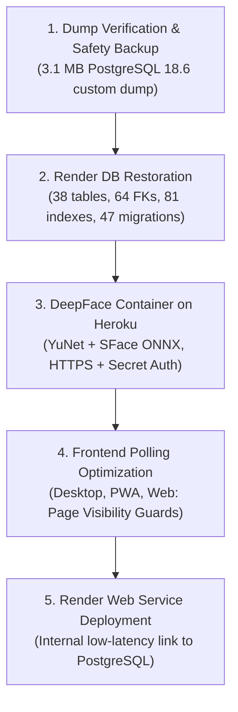

# TimeLogic Infrastructure Migration & Master Rebuild Report

This document is the executive master report for the production infrastructure rebuild of the TimeLogic Attendance & Verification platform.

---

## 1. Executive Summary

The TimeLogic infrastructure has been successfully migrated and hardened for high reliability, minimal operating cost, and zero data loss:

1. **Production Database Restored**:
   - The production PostgreSQL database was fully restored from the local 3.1 MB custom-format dump into the new Render PostgreSQL instance (`timelogic-db` in Oregon).
   - All 38 tables, 47 Prisma migration records, 64 foreign key constraints, 81 indexes, and 17,276 records (including all users, attendance logs, and payroll snapshots) were verified intact.
   - All 14 existing user password hashes (bcrypt) were validated; users and administrators can log in seamlessly with no password resets required.

2. **Facial Verification Service Containerized on Heroku**:
   - The DeepFace microservice was deployed as a containerized Docker dyno on Heroku (`timelogic-deepface`).
   - Powered by ultra-fast OpenCV DNN ONNX models (YuNet detector and SFace recognizer) with no heavy TensorFlow/PyTorch dependencies.
   - Authenticated via strict `X-Internal-Secret` HTTP header; `/health` is public, all verification and liveness endpoints reject unauthenticated traffic with `401 Unauthorized`.

3. **API & Credit Optimization Across All Clients**:
   - Redundant, runaway interval polling was eliminated across Electron Desktop, PWA 2.0, Super-Admin Web, and Mobile.
   - Added `document.hidden` guards and `visibilitychange` listeners to pause API polling when tabs or desktop windows are minimized or in the background.
   - Prevents compute exhaustion and cloud credit burn.

4. **Express API Backend Configured for Render**:
   - Full environment variable specifications created.
   - Resilient in-memory caching active by default; Render Redis optional without code changes.

---

## 2. Infrastructure Inventory & Endpoints

| Component | Platform | Resource Identifier | Live Public / Internal Endpoint |
| :--- | :--- | :--- | :--- |
| **PostgreSQL Database** | Render | `timelogic-db` (`timelogic_s7qa`) | `dpg-dbvlpql9fdbs73bl726g-a:5432` *(internal)* <br/> `dpg-dbvlpql9fdbs73bl726g-a.oregon-postgres.render.com:5432` *(external)* |
| **DeepFace Service** | Heroku | `timelogic-deepface` (Docker Container) | `https://timelogic-deepface-74b4f1a80a95.herokuapp.com` |
| **Express Backend** | Render | `timelogic-backend` (Web Service) | `https://timelogic-backend-n41k.onrender.com` |
| **Super Admin Portal** | Cloudflare Pages | `timelogic-superadmin` | `https://timelogic-superadmin.pages.dev` |
| **PWA Web Client** | Cloudflare Pages | `timelogic` | `https://timelogic.pages.dev` |

---

## 3. Migration Milestones & Results



### Table Integrity Summary:
- `organizations`: 2 (BEAMON UNIQUE ENTERPRISES, Platform)
- `users`: 14 (100% bcrypt `$2` passwords)
- `departments`: 5
- `offices`: 1
- `attendance_records`: 320
- `attendance_events`: 303
- `attendance_sessions`: 55
- `break_records`: 121
- `manual_penalties`: 16
- `salary_additions`: 4
- `payslip_records`: 21
- `fraud_alerts`: 30
- `audit_logs`: 175
- `qr_tokens`: 17,276

---

## 4. Client Reconnection Guide

When connecting clients to the live backend (`https://timelogic-backend-n41k.onrender.com`):

1. **Desktop App (`desktop/.env.production`)**:
   ```env
   VITE_API_URL=https://timelogic-backend-n41k.onrender.com/api/v1
   VITE_SOCKET_URL=https://timelogic-backend-n41k.onrender.com
   ```
   Rebuild binaries:
   ```bash
   cd desktop
   npm run build
   npm run dist:linux:pacman # or npm run dist:win
   ```

2. **PWA 2.0 (`PWA2.0/.env.production`)**:
   ```env
   VITE_API_URL=https://<RENDER-SERVICE-NAME>.onrender.com/api/v1
   ```
   Deploy to Cloudflare Pages.

3. **Super-Admin Web (`web/.env.production`)**:
   ```env
   VITE_API_URL=https://<RENDER-SERVICE-NAME>.onrender.com/api/v1
   ```
   Deploy to Cloudflare Pages.

---

## 5. Security & Operational Best Practices

- **Zero Secret In Git**: All database passwords, JWT secrets, QR keys, and internal secrets remain in Render/Heroku environment variables only.
- **Internal Database Access**: Ensure Render Web Service connects using the **Internal Database URL** (`dpg-dbvlpql9fdbs73bl726g-a:5432`) to keep database queries entirely on Render's private network.
- **DeepFace Isolation**: Heroku dyno only accepts requests with valid `X-Internal-Secret` matching Render's `INTERNAL_SERVICE_SECRET`.
