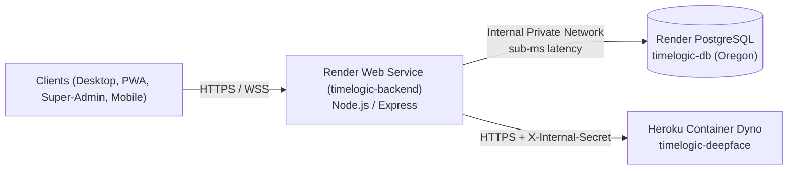

# Render Backend Deployment Guide

This guide provides the complete walkthrough for deploying the TimeLogic Express API backend on Render, linking it with the restored PostgreSQL database and the Heroku DeepFace microservice.

---

## 1. Overview of Architecture



---

## 2. Step-by-Step Deployment Instructions

### Step 1: Create Web Service on Render
1. Open the [Render Dashboard](https://dashboard.render.com).
2. Click **+ New** (top right) ➔ Select **Web Service**.
3. Connect your repository: `https://github.com/akenuw/TIMELOGICS.git` (or select from your connected Git accounts).
4. Configure the service settings:
   - **Name**: `timelogic-backend`
   - **Region**: `Oregon (US West)` *(matches your `timelogic-db` database region)*
   - **Branch**: `main`
   - **Root Directory**: `backend`
   - **Runtime**: `Node`
   - **Build Command**: `npm install && npm run build` (or `npm install`)
   - **Start Command**: `npm run start`
   - **Instance Type**: `Free` or `Starter`

### Step 2: Configure Environment Variables
Under the **Environment Variables** section of the service, enter the following keys:

| Key | Value / Source |
| :--- | :--- |
| `NODE_ENV` | `production` |
| `PORT` | `10000` |
| `DATABASE_URL` | Copy the **Internal Database URL** from `timelogic-db` dashboard: <br/>`postgresql://timelogic_admin:<PASSWORD>@dpg-dbvlpql9fdbs73bl726g-a:5432/timelogic_s7qa` |
| `DEEPFACE_URL` | `https://timelogic-deepface-74b4f1a80a95.herokuapp.com` |
| `INTERNAL_SERVICE_SECRET` | *(The identical secret configured in Heroku config vars)* |
| `JWT_ACCESS_SECRET` | *(Your production JWT access token secret)* |
| `JWT_REFRESH_SECRET` | *(Your production JWT refresh token secret)* |
| `QR_SECRET_KEY` | *(Your production QR code HMAC key)* |
| `UPLOAD_DIR` | `uploads` *(or `/data/uploads` if using a Persistent Disk on Starter plan)* |

> [!TIP]
> **Redis Evaluation**: TimeLogic features an automatic resilient in-memory caching mechanism. If you do not provision a separate Render Redis instance, TimeLogic operates smoothly in memory, eliminating monthly Redis instance costs. If you later provision Render Redis, simply paste `REDIS_URL` and TimeLogic will switch over with zero downtime.

### Step 3: Trigger Initial Deployment
1. Click **Create Web Service**.
2. Render will clone the repository, install dependencies, run Prisma code generation, clear legacy migration states, and start the Express server.
3. Once the build completes, the status will show **Live**.

---

## 3. Post-Deployment Verification Checklist

Once `timelogic-backend` is Live:

1. **Check Health Endpoint**:
   ```bash
   curl -i https://<YOUR-RENDER-BACKEND-URL>.onrender.com/health
   ```
   *Expected Response: HTTP 200 with status "ok" or database status.*

2. **Verify Database Connectivity**:
   Confirm in Render logs:
   ```
   [info] PostgreSQL connected via Prisma
   [info] QR rotation worker started
   [info] Session scheduler started (per-office, multi-org)
   ```

3. **Verify DeepFace Integration**:
   Confirm in Render logs:
   ```
   [info] DeepFace keep-alive ping successful
   ```
